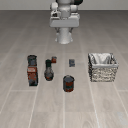

# Results and representative animations

All original main evaluations use20trials/model,initialIDs20–39,tenzero warmup commands,600stepcap. The additional-newstates check usesIDs40–49.

Read [the run index](runs.json) for exact settings, original Slurm IDs, checkpoint hashes and per-episode evidence. Animated examples are individual episodes, not a substitute for the full success counts.

| Method | Setting | Training seed | Condition | Result | Representative clips |
|---|---|---:|---|---:|---|
| act | execute5 | 0 | original_zero_warmup | 17/20 | [success, ID20](media/act_execute5_seed0_original_zero_warmup_success_id20.gif) / [failure, ID27](media/act_execute5_seed0_original_zero_warmup_failure_id27.gif) |
| act | execute5 | 1 | original_zero_warmup | 17/20 | [success, ID20](media/act_execute5_seed1_original_zero_warmup_success_id20.gif) / [failure, ID34](media/act_execute5_seed1_original_zero_warmup_failure_id34.gif) |
| dp | execute5 | 0 | original_zero_warmup | 15/20 | [success, ID20](media/dp_execute5_seed0_original_zero_warmup_success_id20.gif) / [failure, ID21](media/dp_execute5_seed0_original_zero_warmup_failure_id21.gif) |
| dp | execute1 | 0 | original_zero_warmup | 19/20 | [success, ID20](media/dp_execute1_seed0_original_zero_warmup_success_id20.gif) / [failure, ID32](media/dp_execute1_seed0_original_zero_warmup_failure_id32.gif) |
| dp | execute5 | 1 | original_zero_warmup | 12/20 | [success, ID20](media/dp_execute5_seed1_original_zero_warmup_success_id20.gif) / [failure, ID24](media/dp_execute5_seed1_original_zero_warmup_failure_id24.gif) |
| dp | execute1 | 1 | original_zero_warmup | 19/20 | [success, ID20](media/dp_execute1_seed1_original_zero_warmup_success_id20.gif) / [failure, ID32](media/dp_execute1_seed1_original_zero_warmup_failure_id32.gif) |
| baku | temporal_aggregation | 0 | original_zero_warmup | 20/20 | [success, ID20](media/baku_temporal_aggregation_seed0_original_zero_warmup_success_id20.gif) |
| baku | temporal_aggregation | 1 | original_zero_warmup | 6/20 | [success, ID20](media/baku_temporal_aggregation_seed1_original_zero_warmup_success_id20.gif) / [failure, ID21](media/baku_temporal_aggregation_seed1_original_zero_warmup_failure_id21.gif) |
| a2a | flow6_execute1 | 0 | original_zero_warmup | 20/20 | [success, ID20](media/a2a_flow6_execute1_seed0_original_zero_warmup_success_id20.gif) |
| a2a | flow6_execute1 | 1 | original_zero_warmup | 0/20 | [failure, ID20](media/a2a_flow6_execute1_seed1_original_zero_warmup_failure_id20.gif) |
| a2a | flow6_execute1 | 0 | diagnostic_open_warmup | 20/20 | [success, ID20](media/a2a_flow6_execute1_seed0_diagnostic_open_warmup_success_id20.gif) |
| a2a | flow6_execute1 | 1 | diagnostic_open_warmup | 20/20 | [success, ID20](media/a2a_flow6_execute1_seed1_diagnostic_open_warmup_success_id20.gif) |
| a2a | flow1_execute1 | 0 | additional_check | 19/20 | [success, ID20](media/a2a_flow1_execute1_seed0_additional_check_success_id20.gif) / [failure, ID22](media/a2a_flow1_execute1_seed0_additional_check_failure_id22.gif) |
| a2a | newstates_flow6_execute1 | 0 | additional_check | 10/10 | [success, ID40](media/a2a_newstates_flow6_execute1_seed0_additional_check_success_id40.gif) |
| a2a | legacy_labels_matched_control | 0 | timing_ablation_control | 0/20 | [failure, ID20](media/a2a_legacy_labels_matched_control_seed0_timing_ablation_control_failure_id20.gif) |

## Same failed A2A checkpoint, different initialization

The seed-1 checkpoint is unchanged. Original zero warmup fails20/20episodes. Diagnostic open warmup succeeds20/20. These remain different evaluation conditions.

### Original initialization, seed1, ID20

### Diagnostic open initialization, seed1, ID20

## Evidence checks

`export_validation.json` records the export audit of original animation headers and action files. `verification.json` records independent checks on the files included here. Current checkpoint rehashing, if completed, is recorded separately in `maintenance/`. Historical checkpoint hashes alone do not claim new validation after maintenance.
